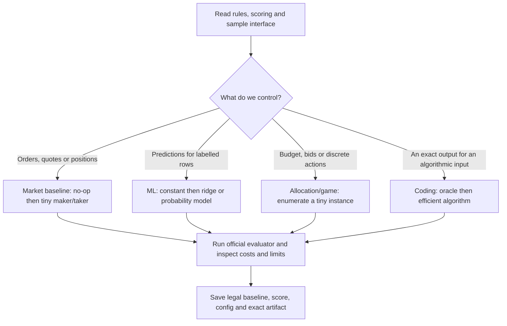

# First 30 minutes with the official task

The four marketing modules may describe one task. Select by the input, decisions and scoring contract.

**Minutes 0–5:** all team members read the objective and restrictions. One owner writes the exact scoring formula with a numerical example. Confirm whether maximising final profit, average score, survival, or probability of winning is the goal.

**Minutes 5–10:** integrator runs the untouched official sample in its actual environment. Record signature, field types, units, available state, CPU/RAM/time, dependencies and submission layout. Reconcile with `COMPETITION_RULES.md`.

**Minutes 10–15:** validation owner checks when each feature/result becomes available. Inspect fees, budget/position limits, opponent coupling and final valuation. Build a tiny example whose answer everyone can compute by hand.

**Minutes 15–25:** choose the closest tested preparation baseline and implement only the official adapter. For a live book verify order acknowledgements/fills/cancellation semantics; for ML use chronological or group-separated splits; for games state payoff and tie rules; for coding compare with a tiny exhaustive oracle.

**Minutes 25–30:** run official evaluation, preserve a known-good artifact and record commands/score. Submit a legal baseline early if submissions are available. Assign one measured improvement per owner.

## Decision checks by family

| Observation | First baseline | Essential failure check |
| --- | --- | --- |
| Bid/ask snapshots and order callbacks | No-op; then position-capped quoting | Touch is not a guaranteed fill; pending orders can breach limits. |
| Bars or trades without exchange order events | Causal signal and explicit execution assumption | Do not reconstruct a FIFO queue or order-level flow from snapshots. |
| Labelled numeric table | Constant then regularised linear model | No target-derived feature; train-only preprocessing; untouched test. |
| Budgeted independent one-time choices | Enumeration then 0/1 knapsack DP | Integer vs fractional, negative rewards, unused budget and fees. |
| Rewards depend on rivals | Explicit payoff, several opponent scenarios | Opponent guesses are assumptions; sharing denominator is nonlinear. |
| Matrix of action payoffs | Best responses; zero-sum maximin only if justified | Verify whether it is zero-sum and report exploitability bounds. |
| Currency conversions | Bounded path DP or negative-cycle search | Apply fees once per edge; enforce maximum number of moves. |
| Exact coding input/output | Brute-force oracle on small cases | Edge cases, complexity, exact signature and unexpected stdout. |

This is a runnable workflow checklist, not a promise that an unknown problem can be solved in 30 minutes.
